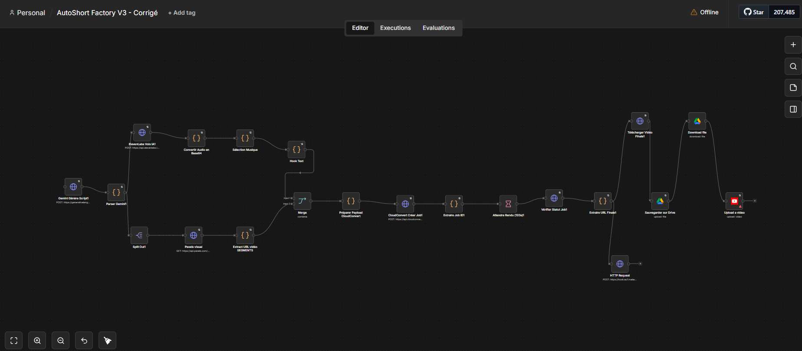
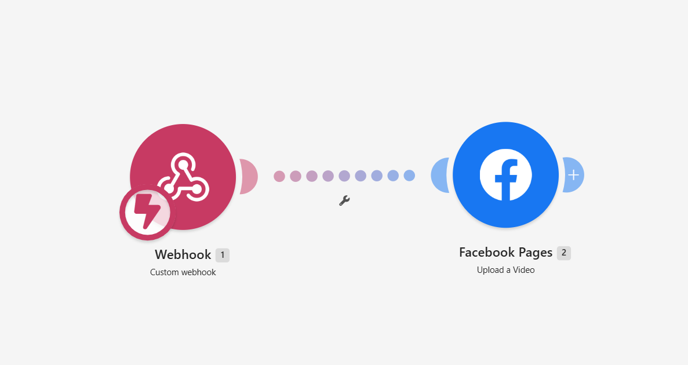

# ViralShorts AI Automator 🚀

Une usine à contenu **100% autonome et gratuite** fonctionnant sous n8n et Make.com. Ce système génère, monte et publie des vidéos courtes (YouTube Shorts, Facebook Reels) avec une qualité narrative et visuelle conçue pour exploser la rétention et l'engagement.

Ne vous fiez pas au mot "automatisé" : **le rendu final est propre, professionnel et indiscernable d'un montage humain.**

## 📺 La preuve en images (Résultats réels)
Ces vidéos ont été pensées, écrites, montées et publiées **de A à Z par ce workflow** pour la chaîne *Esprit d'Acier* :

- [▶️ Voir le résultat sur YouTube Shorts](https://youtube.com/shorts/S-7Ma3NJU14?si=KJR4WSzbA5QsRs1W)
- [▶️ Voir le résultat sur Facebook Reels](https://www.facebook.com/share/r/1M4D9gKKnA/)

*Jetez un œil aux liens ci-dessus pour constater la fluidité de la voix, la pertinence des plans et le style des sous-titres.*

---

## 🧠 Pourquoi ce projet surpasse les bots classiques ?

La majorité des générateurs IA produisent des vidéos génériques et sans émotion. Ce projet résout ce problème à trois niveaux :

1. **Ingénierie Psychologique (Prompting extrême)** : Le cœur du système est un méga-prompt Gemini orienté *Dopamine Retention*, *Storytelling* et *Micro-tensions*. L'IA ne recrache pas des citations Wikipédia, elle écrit des histoires humaines réalistes conçues pour empêcher le swipe.
2. **Qualité de Montage (FFmpeg)** : Le script n8n génère des commandes FFmpeg complexes exécutées sur CloudConvert. Les vidéos B-roll sont recadrées parfaitement en 9:16, l'audio est mixé avec une musique de fond adaptée à l'émotion du texte, et des sous-titres stylisés (boîte noire, typo lisible) sont incrustés en dur.
3. **Contournement de l'API Meta** : Publier automatiquement sur Facebook Pages via leur API officielle est un cauchemar (vérification d'entreprise, mode dev, etc.). Ce projet délègue cette partie à un webhook Make.com, rendant le déploiement accessible à n'importe quel utilisateur en 5 minutes.

## ⚙️ Aperçu de l'usine

### 1. Le Cerveau (Orchestrateur n8n)
Ce workflow gère l'IA, le montage et l'upload YouTube.


### 2. Le Relais (Webhook Make.com)
Ce micro-scénario réceptionne la vidéo finale et la pousse nativement sur Facebook.


---

## 🛠️ Fonctionnalités techniques

- **Pilote Automatique** : Déclencheur Cron n8n paramétré pour tourner 3 fois par jour (modifiable).
- **Casting Visuel Dynamique** : L'IA Gemini découpe son script en segments et génère des mots-clés en anglais pour chercher les meilleures vidéos d'illustration via l'API Pexels.
- **Voix Premium** : Utilisation de l'API ElevenLabs pour un rendu vocal ultra-réaliste, sans ton robotique.
- **Sélection Musicale Intelligente** : La musique de fond change en fonction de l'émotion détectée par l'IA dans le script (mélancolie, motivation, mystère...).
- **Double Publication Native** : Upload simultané sur YouTube et Facebook avec titres viraux, descriptions optimisées SEO et hashtags générés par l'IA.
- **Archivage Cloud** : Sauvegarde automatique de la vidéo finale `.mp4` sur Google Drive.

---

## 🏗️ Architecture du flux

```mermaid
graph TD
  A[Schedule Trigger - 3x/jour] --> B[Gemini IA: Génération Script & Segments]
  B --> C[ElevenLabs: Génération Voix]
  B --> D[Pexels: Recherche Vidéos B-roll]
  C --> E[Merge Data]
  D --> E
  E --> F[CloudConvert / FFmpeg: Montage Vidéo & Sous-titres]
  F --> G[Attente & Vérification Rendu]
  G --> H[Upload Google Drive]
  H --> I[Upload YouTube Shorts]
  G --> J[Webhook vers Make.com]
  J --> K[Upload Facebook Page Reels]
