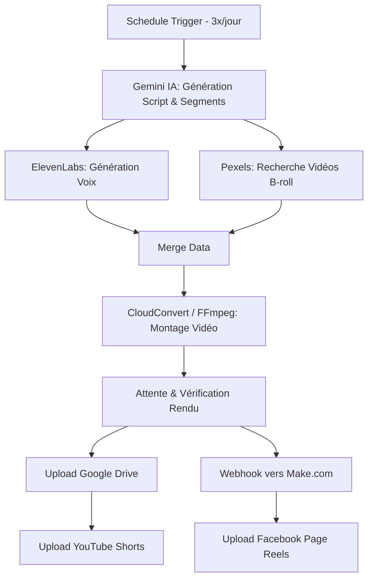

# ViralShorts AI Automator

Une usine à contenu 100% autonome fonctionnant sous n8n et Make.com. Ce système génère, monte et publie automatiquement des vidéos courtes (YouTube Shorts, Facebook Reels) avec une qualité narrative et visuelle optimisée pour la viralité.

## Pourquoi ce projet ?
La création de vidéos générées par IA souffre souvent d'un manque d'émotion et de rétention. Ce projet résout ce problème grâce à un prompt d'ingénierie inversée de la psychologie humaine (Dopamine retention, Storytelling). 

Il contourne également la complexité de l'API Facebook officielle en déléguant la publication à un simple webhook Make.com, rendant le déploiement accessible à tous sans avoir besoin de valider une application développeur Meta.

## Fonctionnalités

- **Automatisation Totale** : Tourne 3 fois par jour via un cron n8n.
- **Storytelling IA** : Scénarios ultra-viraux générés par Gemini Flash avec structure psychologique stricte.
- **Voix Premium** : Synthèse vocale ultra-réaliste via ElevenLabs.
- **Curation Visuelle** : Recherche automatique de vidéos B-roll dynamiques via l'API Pexels.
- **Montage Cloud** : Assemblage vidéo + audio + musique de fond + sous-titrage via FFmpeg sur CloudConvert.
- **Publication Multi-Canale** :
  - Upload direct sur YouTube (n8n).
  - Envoi des données vers Make.com pour un upload natif et sans friction sur les Pages Facebook.
- **Archivage** : Sauvegarde de chaque vidéo montée sur Google Drive.

## Architecture

## Démarrage Rapide

1. Clonez ce dépôt.
2. Créez un fichier `.env` basé sur `.env.example`.
3. Importez `n8n-workflow.json` dans votre instance n8n.
4. Importez `make-blueprint.json` dans votre compte Make.com.
5. Connectez vos credentials dans n8n (Google, YouTube) et Make (Facebook Pages).
6. Activez le scénario Make pour obtenir l'URL du Webhook, et collez-la dans n8n.
7. Activez n8n !

Consultez le [Guide d'installation complet](docs/installation.md) et la [Roadmap d'amélioration](docs/improvements.md).
