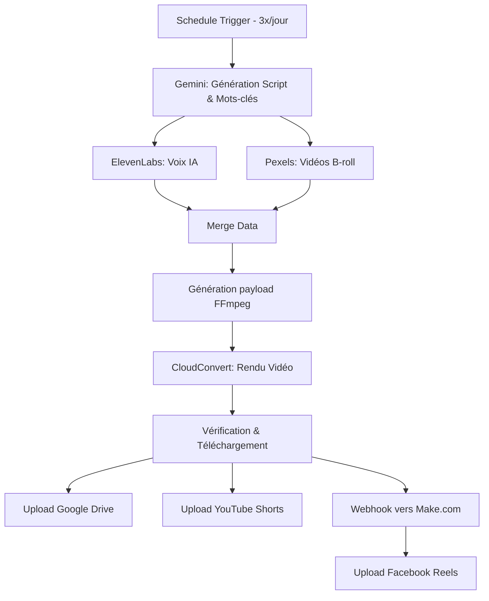

# ViralShorts AI Automator 🚀

Une usine à contenu **100% autonome et sans intervention humaine**, orchestrée par **n8n** et **Make.com**. Ce système génère, monte et publie des vidéos courtes (YouTube Shorts, Facebook Reels) avec une qualité narrative et visuelle conçue spécifiquement pour exploser la rétention et l'engagement algorithmique.

Ne te fie pas au terme "généré par IA" : **le rendu final est propre, professionnel et rivalise avec un montage humain.**

## 📺 Preuves et Résultats en production
Ces vidéos ont été pensées, écrites, montées et publiées **de A à Z par ce workflow** pour la chaîne *Esprit d'Acier* :

- [▶️ Voir le résultat sur YouTube Shorts](https://youtube.com/shorts/S-7Ma3NJU14?si=KJR4WSzbA5QsRs1W)
- [▶️ Voir le résultat sur Facebook Reels](https://www.facebook.com/share/r/1M4D9gKKnA/)

*Constate par toi-même : la fluidité de la voix, la pertinence des plans B-roll (recadrés en 9:16), le mixage musical dynamique et le style des sous-titres incrustés.*

---

## 📸 Aperçu de l'usine à contenu

### 1. Le Cerveau (Orchestrateur n8n)
Gère le prompt psychologique, la récupération des médias, le code de montage FFmpeg et l'upload YouTube.


### 2. Le Relais (Webhook Make.com)
Ce micro-scénario réceptionne la vidéo finale et la pousse nativement sur Facebook Reels pour contourner les blocages de l'API Meta.


---

## 🧠 Pourquoi ce projet surpasse les bots classiques ?

La majorité des générateurs IA produisent des vidéos génériques et sans âme. Ce système attaque le problème sous 3 angles :

1. **Ingénierie Psychologique (Prompting extrême)** : Le cœur du système est un méga-prompt Gemini orienté *Dopamine Retention*, *Storytelling* et *Micro-tensions*. L'IA n'écrit pas des banalités motivantes : elle crée des histoires humaines réalistes (solitude, procrastination, discipline) avec des *pattern interrupts* conçus pour empêcher le swipe.
2. **Qualité de Montage (Code FFmpeg dynamique)** : Le script n8n génère des commandes FFmpeg complexes envoyées à CloudConvert. Les vidéos Pexels sont redimensionnées (`scale=1080:1920:force_original_aspect_ratio=increase`), l'audio est mixé (`amix`) avec une musique de fond adaptée à l'émotion du texte, et un *Hook* texte stylisé est incrusté dès la première seconde.
3. **Bypass de l'API Meta** : Publier automatiquement sur les Pages Facebook via leur API officielle Graph nécessite une vérification d'entreprise complexe. Ce projet délègue cette étape à un simple webhook Make.com, rendant l'automatisation Facebook accessible en 5 minutes.

---

## ⚙️ Stack Technique

| Outil | Rôle dans le workflow |
|---|---|
| **n8n** | Orchestrateur central (Cron 3x/jour, exécution du code JS, appels API). |
| **Make.com** | Relais de publication natif vers la Page Facebook. |
| **Google Gemini Flash** | IA textuelle : Écriture du script, extraction de l'émotion, génération de mots-clés de recherche visuelle, titres et hashtags. |
| **ElevenLabs** | Synthèse vocale ultra-réaliste (Multilingual v2). |
| **API Pexels** | Fournisseur de vidéos B-roll dynamiques via recherche par mots-clés. |
| **CloudConvert (FFmpeg)** | Serveur de montage cloud : exécute les scripts de concaténation, d'incrustation texte et de mixage audio. |
| **Google Drive** | Archivage automatique des vidéos finales au format `.mp4`. |
| **YouTube API** | Publication directe en tant que Short avec métadonnées SEO. |

---

## 🏗️ Architecture du flux



---

## 📂 Arborescence du projet

```text
📁 documents/
   📄 installation.md       # Guide de déploiement pas-à-pas
   📄 improvements.md       # Roadmap des futures fonctionnalités
📁 images/
   🖼️ n8n.png               # Capture du workflow principal
   🖼️ fb.png                # Capture du scénario Make
📄 .env.exemple             # Variables d'environnement requises
📄 n8n-workflow.json        # Le code source du workflow n8n
📄 make-blueprint.json      # Le code source du scénario Make
📄 README.md                # Ce fichier
```

---

## 🚀 Démarrage Rapide

Le système est conçu pour être déployé en quelques minutes si tu possèdes tes clés d'API (Gemini, ElevenLabs, Pexels, CloudConvert).

1. Clone ce dépôt en local.
2. Copie le fichier `.env.exemple` et remplis tes propres clés d'API.
3. Importe le fichier `n8n-workflow.json` dans ton instance n8n.
4. Importe le fichier `make-blueprint.json` dans ton compte Make.com et connecte ta Page Facebook.
5. Active le scénario Make pour obtenir l'URL du Webhook, et colle cette URL dans le dernier nœud de ton workflow n8n.
6. Connecte tes comptes Google/YouTube dans n8n.
7. Active le workflow n8n (il tournera tout seul toutes les 8 heures).

📚 **Pour le paramétrage détaillé étape par étape, consulte le [Guide d'installation complet](documents/installation.md).**

---

## 📝 Auteur & Licence

**Auteur :** Nombré Alidou Salim  
**Licence :** MIT (Libre de modification, de distribution et d'usage commercial).
